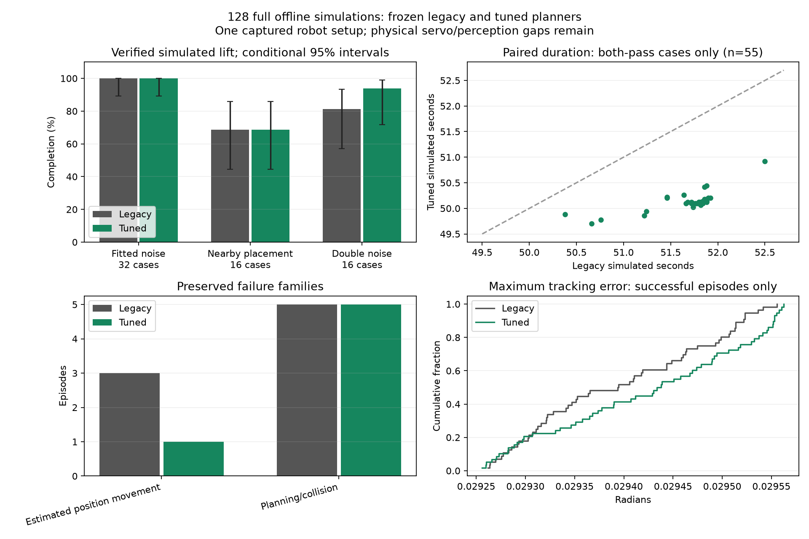

# Larger paired IK/planner evaluation

128 full offline simulations evaluated 64 new cases with both the unchanged
baseline and the frozen tuned candidate. No robot deployment or hardware command
was used. This campaign evaluates the candidate; its failures were not used to
retune either policy during the campaign.

| Condition | Cases per policy | Baseline lifts | Tuned lifts |
| --- | --- | --- | --- |
| Fresh fitted noise, captured can position | 32 | 32/32 | 32/32 |
| Nearby can placement, fitted noise | 16 | 11/16 | 11/16 |
| Double estimate-noise amplitude | 16 | 13/16 | 15/16 |
| Mixed evaluation set | 64 | 56/64 | 58/64 |

The mixed row is not a real-world success-rate estimate. Both policies completed
55 paired cases; three completed only with the tuned policy, one only with the
baseline, and five stopped with both. The exact paired sign-test p-value for the
doubled-noise difference is 0.625: this sample does not establish a reliable
completion-rate improvement. At the original placement, the 32/32 completion
interval is approximately 89.3%-100% conditional on this simulation model.

The tuned sequence averaged **1.60 simulated seconds shorter** over the 55
both-pass pairs. Median peak tracking error over successful episodes was
0.029394 rad baseline versus 0.029436 rad tuned, effectively similar with a tiny
increase in the tuned version. Both stayed below 0.029563 rad maximum, and all
128 episodes recorded zero pregrasp physics-contact steps.

The larger orientation search costs computation: in the fitted-noise group,
episode wall time averaged 15.18 seconds baseline and 24.50 seconds tuned on this
Mac with four concurrent workers. Those wall times include planning, rendering
and accelerated simulation; they are not physical demo durations or an isolated
solver benchmark. Shorter simulated movement does not imply a faster Start-to-
completion time on hardware.



## Recorded failures

Five nearby placements failed identically with both policies before any simulated
commands. The initial hand posture was too close to the newly placed can during
the preflight finger-opening check: four failed on `left_wrist_yaw_link`, one on
`left_hand_middle_0_link`. Their measured model separations were positive,
0.77-9.98 mm, inside the existing 10 mm pregrasp clearance margin. These are
clearance rejections, not observed physics penetrations. Trying different grasp
orientations does not change this initial opening posture.

Placement failures (XY offsets from the captured can, millimetres):

| Case | Offset X | Offset Y | Initial clearance rejection |
| --- | --- | --- | --- |
| `placement-02` | -15 | +5 | Can/wrist, 9.98 mm |
| `placement-03` | -15 | +15 | Can/wrist, 0.77 mm |
| `placement-07` | -5 | +15 | Can/wrist, 5.43 mm |
| `placement-11` | +5 | +15 | Can/wrist, 8.75 mm |
| `placement-15` | +15 | +15 | Can/middle finger, 3.52 mm |

Four doubled-noise episodes stopped at `pre-close` with `Can or table moved
during final reach; refusing to close`: baseline seeds 3004, 3008 and 3015, and
tuned seed 3009. They executed the preceding phases, then froze before issuing
close or lift. The opposite policy completed each of those four seeds. Equal
seeds couple randomness, but policy timing and viewing changes affect the noise
samples; these are not identical exposure sequences.

These cases expose remaining startup-clearance handling and estimate-drift
limitations. No guard was relaxed, and no stop was relabeled as a completed lift.
`analysis.json` records failure details, command counts and collision metadata.

## Reproduction and evidence

`manifest.json` fixes 32 fitted-noise seeds (1000-1031), a 4x4 placement grid
within +/-15 mm (2000-2015), and 16 double-noise seeds (3000-3015). It retains the
captured setup and source checksums. Both policies use the same measured initial
posture, table, camera, PD dynamics and approximate can properties. Lower-body
support is simulated; robot feedback and camera freshness remain synthetic.
Model-fit correlation/jump-tail limitations and postgrasp extrapolation remain.
This campaign does not test different initial arm poses, physical camera latency,
calibration error, real target loss or the remaining real servo tracking gap.

All 128 compressed episodes in `episodes/` retain commands, observations,
trajectories, noise metadata, terminal outcomes, source/dependency provenance and
backend assumptions. Every archive was checksum verified, every episode used
the same runtime sources, all classifier call counts were zero, and there were
no worker exceptions or wall timeouts. Worker logs are retained in `logs/`.
`outcomes.json`, `summary.json` and `analysis.json` keep aggregate and paired
results without discarding failed cases.

```sh
python offline/sim_campaign.py --directory offline/validation/large-sim-campaign-20261008 --jobs 4 --timeout 180
python offline/sim_campaign_report.py --directory offline/validation/large-sim-campaign-20261008
python offline/run.py --test test_sim_campaign_failures
```

The campaign command resumes verified results and refuses changed sources or
inputs; use a fresh output directory for a new run. Each worker uses the offline
network/DDS blocker and single-threaded BLAS. Three new full-simulation regression
tests reproduced a startup-clearance stop and both policies' noisy pre-close
stops, verifying zero initial commands and no close/lift after uncertainty.
These tests pass by preserving the intended stops; they do not fix the residual
pickup failures. Together with campaign accounting, lab integration and the two
older fixed-noise suites, **17 focused checks passed**. Each suite verified all
143 existing fixture hashes. The broader known head-camera simulation failure
was not included or resolved in this campaign.
