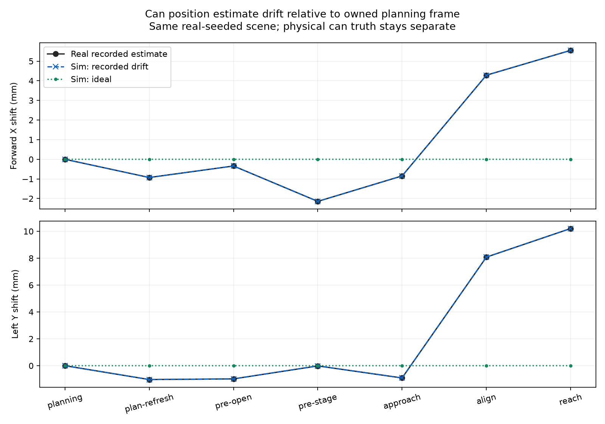

# Recorded can estimate noise: real-seeded simulation

The ideal simulation had nearly constant can estimates before grasping, while
real estimates showed millimetre jitter and persistent shifts. The original red
check compared 11.6166 mm of real planning-to-reach drift against 0.0197 mm in the
previous saved simulation and failed the requirement that simulation reach at
least half the recorded drift.

`PositionNoise` now replays relative XY offsets from sixteen native observations
in two real trials. A fixed seed selects a whole recording, preserving correlated
jitter and bias. The default seed 7 selects `approach-drift`. Geometry first fits
rendered RGB-D, then noise perturbs the estimate before tracker acceptance;
planning and movement checkpoints consume that estimate. It never moves the
physical can or supplies physical object truth to perception.

All three new runs use the same real-seeded held-state setup and P150/D3 arm
control, with `TargetTracker(identity_mode='color_depth')` and zero YOLO calls.

| Run | Owned planning-to-reach estimate change | Result |
| --- | ---: | --- |
| Ideal (`none`) | 0.00056 mm | Simulated lift and hold verified |
| Recorded approach drift | 11.61703 mm | Stops at reach, before reach/close commands |
| Recorded handover bias | 5.43084 mm after owned replan | Simulated lift and hold verified |

The real approach trace changed 11.61663 mm. Maximum relative XY error between
its phase observations and the noisy simulation is 0.00056 mm. The handover
trace shifts 10.39728 mm in simulation versus 10.40299 mm recorded; the existing
owned-state replanning handles this bias without changing a guard.

The noisy approach returns `Can or table moved during approach; replanning
required` at 25.10 simulated seconds. The ideal run completes at 51.82 simulated
seconds. These durations are simulation time, not wall-clock or predicted real
completion times. The physical can has no pregrasp contact in the drift case.



## Reproduction and evidence

From the physical directory, with the offline Python dependencies installed:

```sh
HANDOFF_OFFLINE=1 PYTHONPATH=offline:. python sim_runtime.py --identity-mode color_depth --setup-json offline/validation/position-noise-20261008/setup.json --noise-trace approach-drift --output offline/reports/noisy-can.json
HANDOFF_OFFLINE=1 PYTHONPATH=offline:. python sim_runtime.py --identity-mode color_depth --setup-json offline/validation/position-noise-20261008/setup.json --position-noise none --output offline/reports/ideal-can.json
python offline/run.py --test test_simulation_position_noise
python offline/run.py --test test_sim_position_noise
python offline/position_noise_comparison.py
```

Create `offline/reports` first. The first simulation intentionally exits nonzero
on the reproduced movement rejection. The regression asserts that outcome and
passes. `--noise-seed` repeats trace selection; `--noise-scale` scales offsets
for stress tests; scale 1 matches the saved trace. `--position-noise none` restores
the ideal baseline. No physical controller or robot configuration was changed
or deployed for this work.

`setup.json` retains the prior real measured body/hand positions and velocities,
camera intrinsics, calibration and estimated initial can pose. Camera calibration
and supported-base assumptions remain those of the prior sim/real comparison.
The profile preserves source archive/event checksums, frame IDs, observation
times, XY estimates, exposure ages and cylinder-fit residuals. Full run JSON is compressed as `ideal.json.gz`, `approach-drift.json.gz` and
`handover.json.gz`; the comparison script reads either JSON or gzip. These results
preserve noisy/unperturbed estimates, all requested joint targets, dependency and
source hashes, and object truth as a separate audit field. Compiled `.planning`
models are generated locally and ignored by Git.

## Limits

This reproduces recorded **estimate variability**, not calibrated sensor accuracy.
There was no independently measured can ground truth, so the recorded shifts may
include real movement. It is a phase-correlated replay of two traces, not a fitted
continuous-time sensor distribution. Equal trace-selection weights support test
coverage and do not estimate real failure probabilities. No Z/depth-pixel noise,
latency, or postgrasp variability was fitted. Unrecorded later phases hold the
last offset and explicitly mark it extrapolated. An already-owned recording's
planning/refresh observations are reused for the simulator's second preflight.
The 10 mm movement and 40 mm tracking gates remain unchanged.

## Validation results

Eight new noise regressions passed, including the full real-seeded MuJoCo
RGB-D/tracker sequence. Thirteen existing physical-simulation regressions
also passed with the ideal mode explicitly selected. The broader check ran
28 tests: 27 passed and the existing head-camera color/depth lift-verification
case still failed with `Color/depth can target absent/ambiguous`. That unrelated
baseline failure is preserved as a failure, not skipped or converted to a pass.
All 143 existing evidence hashes verified in the offline runner. Per-module
results and `tests.json` retain the complete outcomes.
