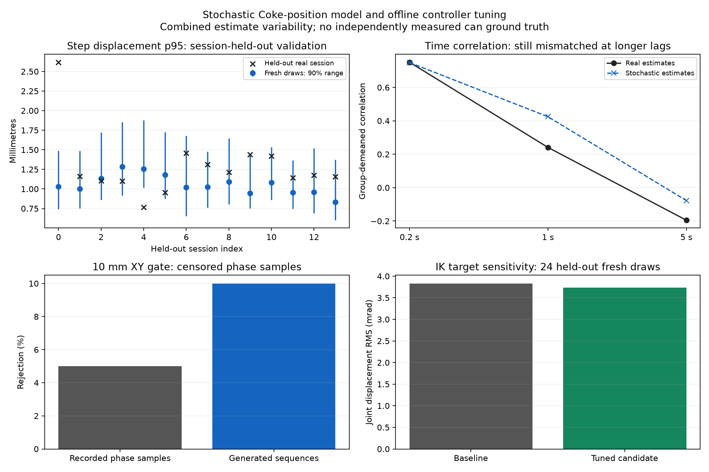

# Stochastic perception model and offline IK/planner candidate

No hardware commands or deployments were used for this work. The comparison was
reported before changing the solver/planner, then the bounded candidate was
implemented and evaluated against the baseline.

| Property | Previous simulation | New simulation | Real recordings |
| --- | --- | --- | --- |
| Can position | Ideal geometry, or one of two fixed phase traces | Fresh seeded XY jitter, correlated drift and persistent jumps | Chronological estimates with unknown physical can motion |
| Time behavior | Fixed trace advanced by phase | Advances with elapsed time during motion | Exposure times preferred; receipt-age fallback recorded |
| Viewing conditions | Two specific examples | Stationary, moving-arm and reduced-support regimes | Arm speed and support proxies; some feedback missing |
| Trajectory planning | First feasible grasp, 12 mm endpoint IK bound | Three checked candidates, +/-0.1 rad yaw search, 5 mm endpoint IK bound | Existing deployed policy; tuned candidate not deployed |
| Hardware dynamics | MuJoCo PD dynamics | Same dynamics | Servo delay, friction, calibration and feedback gaps remain |

## Evidence and validation

`corpus.json.gz` contains 1,993 pregrasp observations from 26 deduplicated trial
groups and 46 source exports with checksums. Overlapping exports are merged by
frame identity before fitting. Splits hold out complete trial groups, not whole
robot boots; groups can come from the same sensor run. This is the available
recording corpus, not a claim that missing robot data was recovered.

`profile.json` and the packaged `stochastic_noise_profile.json` are identical.
Refitting from this corpus reproduces the profile byte for byte. Independent can
ground truth and verified stationary segments are absent. Postgrasp samples are
excluded from fitting; postgrasp simulation noise is labeled extrapolated.
Moving-arm classification uses measured feedback when available, otherwise
commands; 569 observations have no recent arm samples. Reduced support is an
occlusion proxy, not annotated occlusion truth.

The model combines anisotropic Gaussian frame jitter, correlated drift and a
compound-Poisson jump process with fitted session-to-session scale variability.
Where the fitted drift timescale reaches the 120-second search boundary, the
sampler uses the Brownian diffusion limit instead of claiming a measured return
to the mean. Initial absolute bias is not identified. There are only two
qualifying short-time jumps (3.11 and 3.21 mm); their frequency and size remain
weakly identified. The separate 10.4 and 11.6 mm recorded traces remain fixed
failure regressions and are not treated as well-measured jump probabilities.

`held-out.json` reports leave-one-group-out validation with 64 fresh draws per
group. Fourteen groups have enough consecutive samples for distribution checks;
twenty have evaluable recorded phase checks.

| Metric | Real | Generated |
| --- | --- | --- |
| Step-displacement p95 across dense groups | 0.77-2.62 mm | 11/14 real values inside generated 90% envelopes |
| Group-demeaned correlation at 0.2 seconds | 0.751 | 0.749 |
| Correlation at 1 second | 0.241 | 0.425 |
| Correlation at 5 seconds | -0.195 | -0.077 |
| Recorded XY phase-check stops | 1/20 (5%) | Mean generated probability 10% |

The last row covers only observed 10 mm XY checks. Logs terminated by other
failures are censored; these numbers do not establish complete-demo stop rates.
Longer-lag correlation and tail variability still mismatch. Camera latency,
target loss, Z/depth-pixel error, calibration error and motor dynamics are not
fitted by this model. It is a broader stress model, not calibrated sensor accuracy.

## Controller tuning

The candidate in `candidate-planner.json` is packaged as
`g1_can_handoff/noise_aware_planner.json`. `ik-sweep.json`, `ik-jac-sweep.json`,
`planner-sweep.json` and `orientation-sweep.json` retain accepted and rejected
settings. Nonzero reference regularization made target sensitivity worse. Large
yaw changes were also worse. The final ranking checks all four joint goals,
keeps regularization zero and unit scaling, and chooses a small local yaw search.
All paths still require the existing collision, joint, tracking and time checks.

Twenty-four separate fresh draws (seeds 200-223) gave joint-target RMS changes
of 0.003831 rad for the baseline and 0.003734 rad for the candidate: **2.54%
lower sensitivity**. All targets were reachable from the captured held state.
This measures command sensitivity, not actual motor tracking accuracy.

`controller-comparison.json` and the compressed `baseline-*.json.gz` /
`candidate-*.json.gz` files retain four paired full simulated pickups from the
real-seeded setup. Both policies verified lift on all four seeds (200-203).
Mean simulated duration was 51.70 seconds baseline and 50.13 seconds candidate.
These four seeds do not establish a general success rate. Archived runs retain
their source hashes; subsequent deadline enforcement and CLI metadata changes
are covered by the final focused regression and tuned integration reports.

The previously measured P=150 servo gap remains: the prior ideal replay settled
around 0.0024 rad versus about 0.0398 rad in real feedback. Neither adding XY
noise nor this IK tuning removes that dynamics gap. No physical result was
measured in this task.

`test_*.json` contains focused module results; `tests.json` aggregates them.
The two fixed noise traces, full noisy pickup, covariance/seed/time behavior,
candidate revalidation, cancellation, planning deadline and existing collision
regressions are covered. Each offline run verifies 143 existing fixture hashes.
The previously known head-camera target-loss simulation failure was not rerun
or resolved by this work; this is a focused passing set, not the entire suite.

Reproduce commands and rollback flags are in [the offline guide](../../README.md#stochastic-position-noise-and-planner-tuning).
