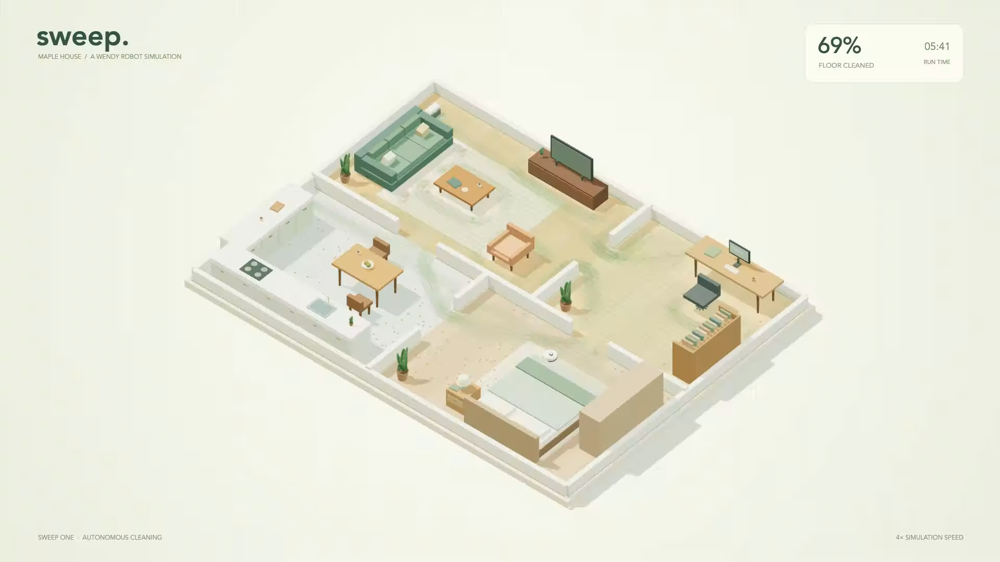

# Sweep

A robot vacuum that cleans a furnished virtual home inside a WendyOS VM.
The project includes its MuJoCo physics model, autonomous controller, house
layout, browser viewer, and video recorder. You can clone and run it without
any other Wendy source repositories.



The sample is a 12 by 9 metre home with a living room, kitchen, bedroom, and
study. Dust disappears when the robot's brush passes over it. The robot follows
alternating sweep lanes, routes around furniture, revisits missed dirt, and
returns to its dock.

## Run locally

Install [uv](https://docs.astral.sh/uv/getting-started/installation/), then run:

```sh
./scripts/run-local.sh
```

Open http://127.0.0.1:18881. Select **Start cleaning** to begin. You can pause,
restart, return to the dock, and run at up to 32 times simulation speed.
Drag to orbit the house and scroll to zoom. The camera buttons select an
isometric view, a floor plan, or a view that follows the vacuum.

## Run in a real WendyOS VM

Install the [Wendy CLI](https://docs.wendy.dev/latest/), QEMU, and a container
builder, then run:

```sh
./scripts/run-vm.sh
```

The script creates or reuses a dedicated `house-vacuum` VM, builds this project's
Dockerfile, and deploys it with `wendy run`. It prints the forwarded viewer URL.
The local viewer relay serves browser assets and sends API calls to the VM.
The Python simulator runs inside the VM. The browser displays the simulation's
actual position, dust, coverage, and mission state.

[VM setup and builder options](docs/VM.md) cover Docker, Apple Container, custom
VM names, ports, and stopping the VM. No GPU is required.

## Make a video

For a live clip, click **Record clip** in the viewer. Click again to stop and
download a 1080p WebM. The clip includes the 3D scene and mission statistics.
The browser must support canvas recording. Chromium works well.

For a reproducible MP4 of a complete mission:

```sh
./scripts/record.sh --output media/maple-house.mp4
```

This runs a fresh mission with seed 7, renders its MuJoCo scene at 1280 by 720
and 24 frames per second, and adds camera cuts and statistics. The default
time lapse compresses 20 simulated seconds into one video second. A JSON report
next to the video records the final cleaning result.

```sh
# Keep the camera wide, or produce a 1080p floor-plan video.
./scripts/record.sh --camera overview --speed 16
./scripts/record.sh --camera top --width 1920 --height 1080
```

On a headless Linux machine, install Mesa's OSMesa library and run with
`MUJOCO_GL=osmesa`. The Docker image already includes this library and FFmpeg.
The browser recorder and MP4 renderer both use the same controller and physics.

## Change the house

Edit [assets/home.json](assets/home.json). Positions and dimensions are in metres.
The origin is the bottom left of the floor plan. Each furniture item has a
centre, footprint, height, colour, and display kind. Walls are rectangular
footprints. Doorways are gaps between wall sections. Keep a clear route from
the dock to each room.

To use a separate layout without changing the sample:

```sh
uv run robot-vacuum serve --home /path/to/home.json
uv run robot-vacuum record --home /path/to/home.json --output media/my-home.mp4
```

The controller uses the supplied map. It does not reconstruct your real home
or perform SLAM. Furniture footprints are solid obstacles. Coverage measures
the reachable floor that the brush can clean, excluding walls, furniture, and
disconnected areas. The mobile base uses planar MuJoCo joints and velocity
actuators with a differential-drive command model. It is a simulation demo,
not a driver for a physical vacuum.

## Project files

| File | Purpose |
| --- | --- |
| `wendy.json`, `Dockerfile`, `uv.lock` | Wendy app permissions, image, and pinned Python dependencies |
| `assets/home.json` | Shared house and robot dimensions |
| `robot_vacuum/world.py` | MuJoCo model and furnished scene |
| `robot_vacuum/planner.py` | Navigation grid, coverage lanes, and A* routes |
| `robot_vacuum/simulation.py` | Robot control, brush cleaning, and mission state |
| `robot_vacuum/server.py` | HTTP viewer and fixed-step physics worker |
| `robot_vacuum/record.py` | MP4 rendering and mission report |
| `static/` | Offline 3D viewer and vendored Three.js |
| `scripts/` | Local run, VM deployment, and recording commands |

Run the checks with:

```sh
uv sync --frozen
uv run --frozen python -m unittest discover -s tests -v
wendy json validate wendy.json
```

This demo is part of the [Wendy demos repository](../README.md). Generated
videos and the VM disk stay outside Git. Share videos separately. The project
uses the MIT license. Three.js retains its own MIT license in
`static/vendor/LICENSE`.
